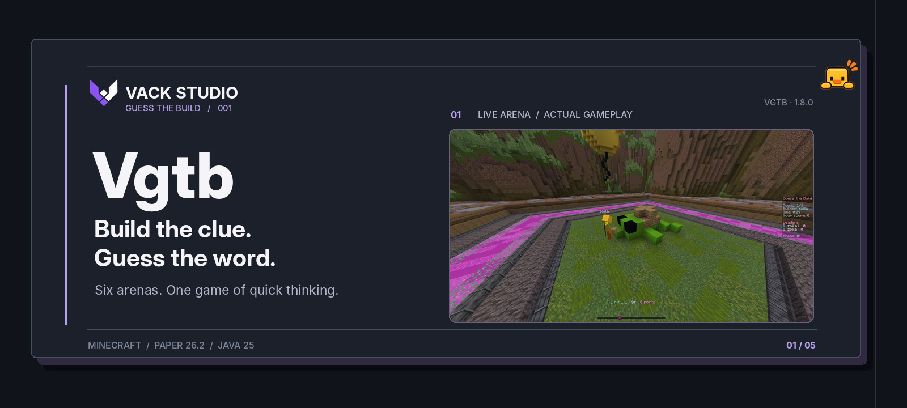
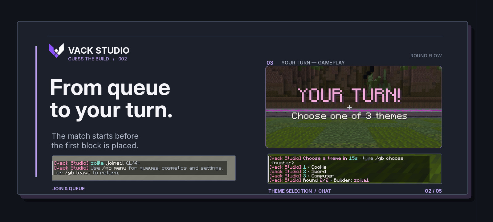
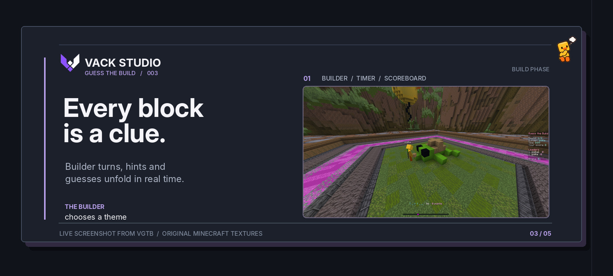
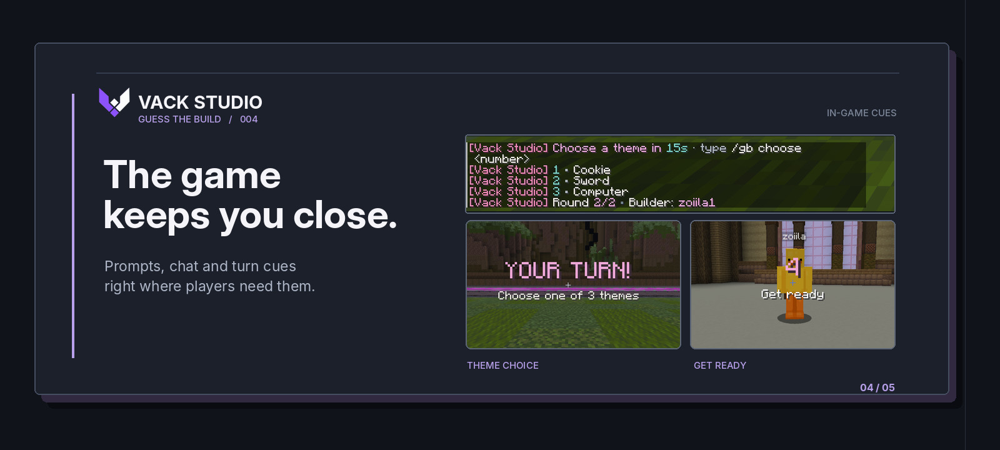
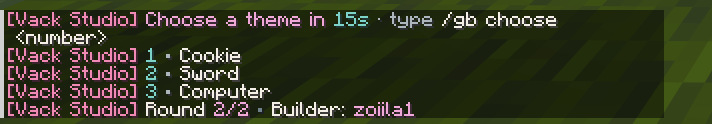
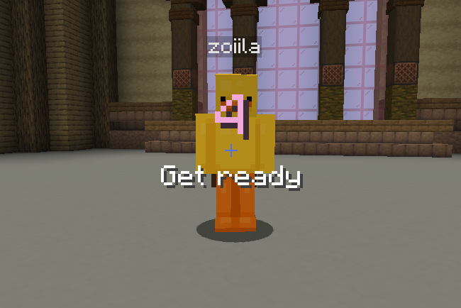
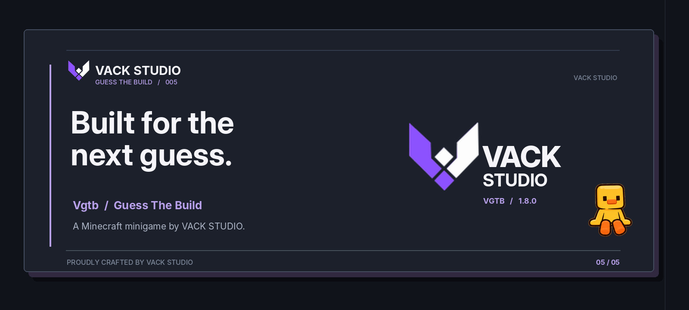

<p align="center">
  
</p>

# Vgtb 

**Build the clue. Guess the word.**

**Vgtb** is a Minecraft Guess The Build minigame by **VACK STUDIO**. Take a turn as the builder, choose a theme, then turn blocks into clues while other players guess through chat. The game tracks rounds, hints and scores across **six manually configured arenas**.

> [!IMPORTANT]
> **Commercial plugin.** Vgtb is proprietary software. This public repository contains product information, not the source code or a downloadable JAR. Builds are distributed privately by VACK STUDIO under authorization.

## From queue to your turn

<p align="center">
  
</p>

**How does a round begin?** 

Players enter an arena or a capacity queue. When a builder's turn arrives, the game presents theme choices and a limited selection window. The builder picks a topic and starts constructing it in the arena; everyone else watches for the answer.

## The build phase

<p align="center">
  
</p>

A player builds the selected theme in an existing world while opponents submit guesses in chat. Hints and scoring keep the round moving, and builder turns rotate through the match.

## In-game cues

<p align="center">
  
</p>

Vgtb communicates the essentials through in-game chat, titles, the round timer and the scoreboard. Player language preferences support **English and Arabic**, selected with `/gb language` and saved per player.

<table>
  <tr>
    <td align="center" width="50%">
      <strong>Theme selection</strong>
      
    </td>
    <td align="center" width="50%">
      <strong>Get ready</strong>
      
    </td>
  </tr>
</table>

## Enter a game

| Action | Command |
| --- | --- |
| Enter a specific arena | `/gb1` through `/gb6` |
| Join a capacity queue | `/gb game 4`, `/gb game 8` or `/gb game 16` |
| Select queue and arena | `/gb game 4 2` |
| Change language | `/gb language`, `/gb language en` or `/gb language ar` |
| Leave a match | `/gb leave` |

Configured game sizes are **4, 6, 8 and 16** players. Their default start thresholds are **3, 5, 6 and 12**, respectively.

## Set up arenas

Vgtb uses **existing Minecraft worlds and administrator-positioned arenas**. It does not generate maps or worlds. At each chosen location, use the arena setup commands to define its waiting, lobby, game and spectator points, followed by the play-area bounds.

```text
/gb setwaiting <arena>
/gb setlobby <arena>
/gb setgame <arena>
/gb setspectator <arena>
/gb setpos1 <arena>
/gb setpos2 <arena>
```

Define every position and both boundary corners before opening an arena to players. 

Admin setup and `/gb pack` diagnostics require `gb.admin`. Resource-pack menus supplied by VPackEngine require `vpack.use`.

## Companion integrations

Vgtb can run with its standard cosmetic inventory. Optional companion plugins add resource-pack profiles, menus, music and player heads.

| Companion | Integration |
| --- | --- |
| **VPackEngine 1.1.0-preview.2** | Waiting/game pack profiles, per-arena overrides, language-specific cosmetic menus and safe context cleanup |
| **VMusic 1.7.0** | Optional NBS waiting-room track and game cues, with native audio fallback |
| **VHeads 1.0.1** | Optional head management |

When VPackEngine or an expected menu/pack is unavailable, the standard cosmetic inventory remains available. Pack delivery is configured in VPackEngine rather than being forced by Vgtb.

## Requirements and verification

| Item | Version or status |
| --- | --- |
| Publicly documented Vgtb version | **1.8.0** |
| Target server | **Paper 26.2 build 133** |
| Java | **Java 25** |
| Maps | **Six manually configured arenas** |
| Leaf / Folia / Bedrock | **Not verified** |

A previously reported private Java 25 CI run built the plugin and passed **24 tests**, covering integration contexts, resource readiness, request isolation and lifecycle invalidation. Those results are build/service checks: full live multiplayer acceptance, pack rendering, audio and cleanup still require in-game verification.

## Availability

Vgtb is privately distributed software by **VACK STUDIO**. Contact VACK STUDIO for availability and written terms.

<p align="center">
  <a href="https://builtbybit.com/members/vack-studio.891381/#latest-activity">BuiltByBit</a>
  &nbsp;&nbsp;&middot;&nbsp;&nbsp;
  <a href="https://discord.gg/y45brtZBEE">Discord</a>
</p>

<p align="center">
  
</p>

<p align="center"><sub>Copyright © 2026 VACK STUDIO. All rights reserved. Third-party components retain their respective rights.</sub></p>