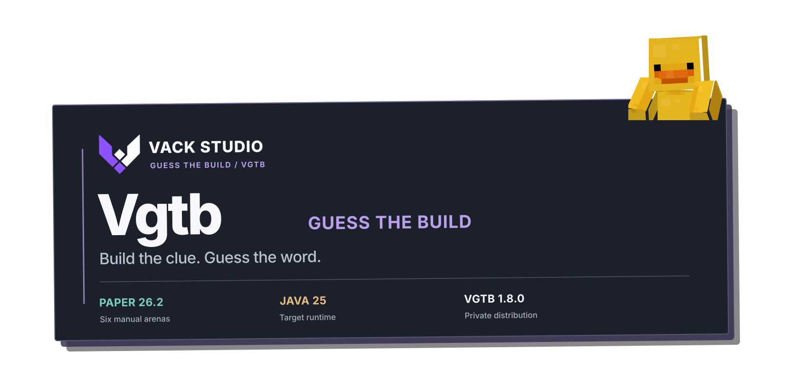
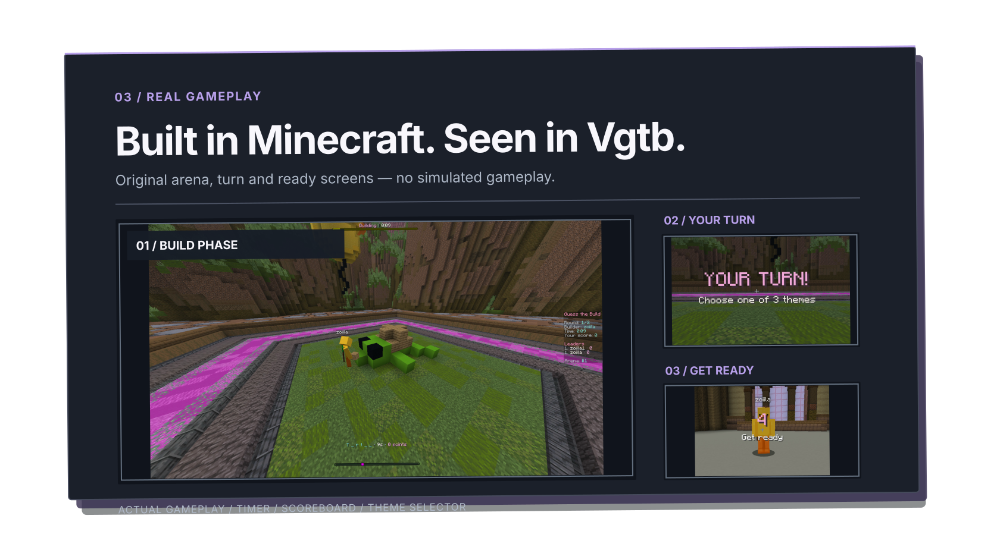

  

# Vgtb 

**Build the clue. Guess the word.**

**Vgtb** is a turn-based Minecraft **Guess The Build** minigame from **VACK STUDIO**. Every round puts one player in the builder's spot: choose a secret theme and bring it to life with blocks while everyone else tries to guess the answer in chat.

It's a game of imagination, quick thinking and friendly competition, with **builder rotation, theme selection, timed rounds, hints and scoring** keeping the experience moving.

> [!IMPORTANT]
> **Commercial plugin.** Vgtb is proprietary software by VACK STUDIO. This public repository showcases the minigame; the source code and installable builds are distributed privately with authorization.

## What is Guess The Build?

**One builder. Everyone guesses.** 

  

| Step | In the game |
| --- | --- |
| **Join a match** | Enter one of six manually configured arenas or join a queue for your preferred player capacity. |
| **Choose a theme** | When it's your turn, select the secret subject you'll bring to life with Minecraft blocks. |
| **Build the clue** | Create a recognizable build while the other players watch and interpret your clues. |
| **Guess and score** | Everyone else submits answers in chat. Hints help the round progress, scores update, and the builder role rotates. |

### Designed for multiplayer rounds

Vgtb supports **4, 6, 8 and 16-player** game sizes across **six arenas**. The corresponding default starting thresholds are **3, 5, 6 and 12 players**. Players can keep their preferred **English or Arabic** language setting.

Rather than requiring generated maps, the arenas are defined by administrators in existing worlds, making it possible to prepare different building spaces for your community.

## See Vgtb in action

  

These are authentic Vgtb gameplay captures. Explore the original images: [building arena](assets/screenshots/building-arena.jpg) · [Your Turn](assets/screenshots/your-turn.jpg) · [Get ready](assets/screenshots/get-ready.jpg).

## Arena preparation & useful tips

  

A well-prepared Vgtb arena makes building easy to follow and guessing enjoyable. Each match uses an existing Minecraft world, with positions chosen for waiting, lobby entry, the active game and spectators.

| Focus | What matters |
| --- | --- |
| **Building space** | Give the builder a clear, usable area with enough room for players to recognize the result. |
| **Player locations** | Keep waiting, lobby, active gameplay and spectator positions separate and accessible. |
| **Arena boundaries** | Define the building area using its opposite corners so players understand the intended limits. |
| **Round flow** | Plan how players enter, spectate and return to the lobby after the action. |

**Tip from Mini Zoiila** 

Before inviting a full lobby, walk through the experience with a small group. Make sure that players have safe spawn locations, spectators can follow the builder without interrupting, and the next round can begin smoothly.

## Configuration examples

Want to explore the available gameplay, arena, UI and message settings? The [configuration examples](examples/README.md) show **selected YAML options** without exposing Vgtb's private source code.

| Example | Explore |
| --- | --- |
| [Gameplay & UI](examples/config.example.yml) | Match sizes, round timing, scoreboard presentation and audio defaults |
| [Manual arena](examples/manual-arena.example.yml) | How existing worlds and manually prepared arenas are represented |
| [Messages](examples/messages.example.yml) | English player-facing announcements and placeholders |
| [Menus](examples/menus.example.yml) | Inventory layout and builder theme-selection slots |

These are **reference snippets, not full replacement files**. Actual arena positions, private assets and complete version-specific defaults remain outside the public repository.

## Optional companion features

Vgtb includes a standard cosmetic inventory. Companion plugins can extend the presentation and game atmosphere:

| Companion | Player experience |
| --- | --- |
| **VPackEngine 1.1.0-preview.2** | Resource-pack profiles and optional language-aware cosmetic menus for waiting and gameplay. |
| **VMusic 1.7.0** | Optional waiting-room audio and game cues, with native sound fallback. |
| **VHeads 1.0.1** | Optional player-head management. |

The standard cosmetic inventory stays available when optional resource-pack menus are not present.

## Requirements

| Component | Target |
| --- | --- |
| Vgtb | **1.8.0** |
| Server | **Paper 26.2 build 133** |
| Java | **Java 25** |
| Arena model | **Six manually configured arenas in existing worlds** |

Other platforms such as Leaf, Folia and Bedrock are **not verified**. The specifications above describe the documented target, rather than promising compatibility with other platforms.

## Get Vgtb

**Vgtb is a commercial minigame by VACK STUDIO.** For access, product questions and licensing information, use the official BuiltByBit and Discord links below.

---

  

  
  &nbsp;&nbsp;&nbsp;&nbsp;
  

<strong>License &amp; rights — VACK STUDIO</strong>

Copyright © 2026 VACK STUDIO. All rights reserved.

The plugin, documentation and original artwork are proprietary. Redistribution, modification or publication require written authorization from VACK STUDIO. Third-party components retain their respective rights.

