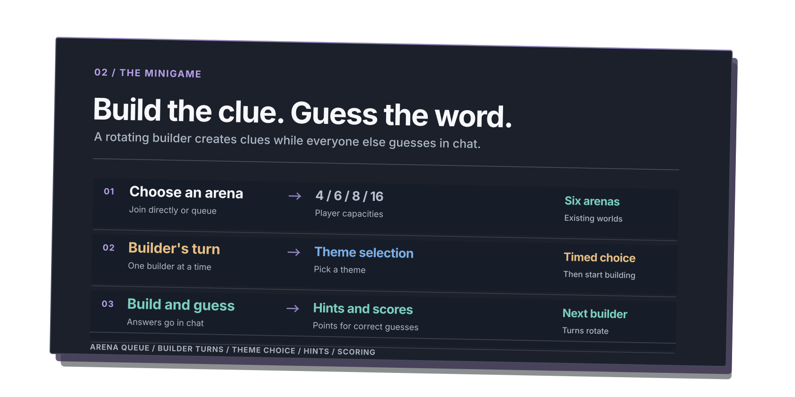
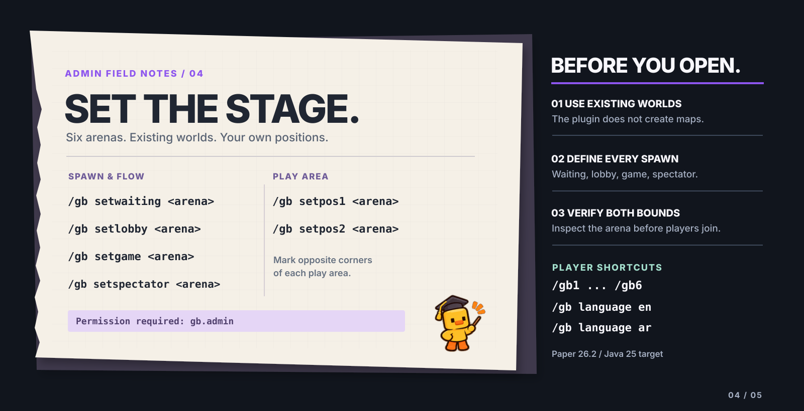
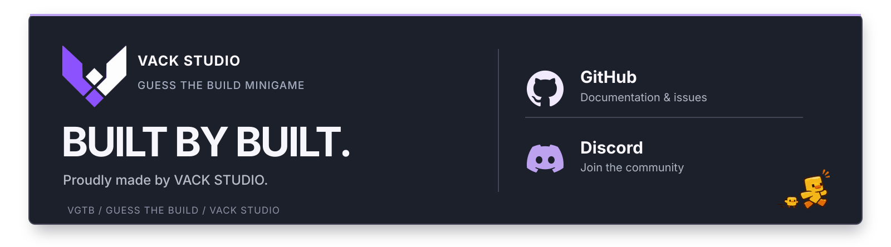

<p align="center">
  
</p>

# Vgtb

**Build the clue. Guess the word.**

**Vgtb** is a Minecraft Guess The Build minigame by **VACK STUDIO**. A player becomes the builder, selects a theme, and turns blocks into clues as everyone else tries to guess it through chat. The game tracks builder turns, hints, rounds, scores and the round timer.

> [!IMPORTANT]
> **Commercial plugin.** Vgtb is proprietary software. This public repository contains product information, not the source code or a downloadable JAR. Builds are distributed privately by VACK STUDIO under authorization.

## What is Vgtb?

<p align="center">
  
</p>

Players can join a queue, take a turn as the builder, choose a theme and start placing clues. Opponents watch the build and race to guess the answer in chat. Vgtb supports **six administrator-positioned arenas** in existing worlds, configured game sizes of **4, 6, 8 and 16** players, and saved **English/Arabic** preferences. The default start thresholds for those game sizes are **3, 5, 6 and 12**, respectively.

## Screenshots from real gameplay

<p align="center">
  
</p>

The Minecraft captures in this gallery are genuine user-provided game screenshots. They have been placed into a manually designed composition; no AI-generated gameplay, fictional GUI or synthetic Minecraft blocks were added.

## Configuration and setup tips

<p align="center">
  
</p>

Vgtb uses **existing Minecraft worlds and manually defined arena locations**. It does not generate worlds or maps. As an administrator, stand at each position and configure the chosen arena:

```text
/gb setwaiting <arena>
/gb setlobby <arena>
/gb setgame <arena>
/gb setspectator <arena>
/gb setpos1 <arena>
/gb setpos2 <arena>
```

Set all four locations and both opposite play-area corners before opening an arena to players. Administrative setup and `/gb pack` diagnostics require **`gb.admin`**.

### Player commands

| Task | Command |
| --- | --- |
| Join a specific arena | `/gb1` through `/gb6` |
| Join a capacity queue | `/gb game 4`, `/gb game 8` or `/gb game 16` |
| Specify the arena | `/gb game 4 2` |
| Change language | `/gb language`, `/gb language en` or `/gb language ar` |
| Leave a match | `/gb leave` |

### Optional companion plugins

Vgtb can use its standard cosmetic inventory without external UI integrations. Companion plugins add extra features:

| Companion | Integration |
| --- | --- |
| **VPackEngine 1.1.0-preview.2** | Waiting/game pack profiles, per-arena overrides, language-specific cosmetic menus and owned-context cleanup |
| **VMusic 1.7.0** | Optional NBS waiting-room track and in-game cues, with native audio fallback |
| **VHeads 1.0.1** | Optional player-head management |

If VPackEngine or its required menus/resources are unavailable, the standard cosmetic inventory remains available. VPackEngine resource-pack menus require `vpack.use`.

## Requirements and verification

| Item | Version or status |
| --- | --- |
| Publicly documented Vgtb version | **1.8.0** |
| Target server | **Paper 26.2 build 133** |
| Java | **Java 25** |
| Arenas | **Six, manually configured** |
| Leaf / Folia / Bedrock | **Not verified** |

A previously reported private Java 25 build passed **24 automated tests**, covering integration contexts, resource readiness, request isolation, supersession and lifecycle invalidation. Build/service checks do not establish full live multiplayer acceptance, audio, pack rendering or complete runtime cleanup; these still need in-game verification.

## Availability

**Vgtb is commercial software, distributed privately by VACK STUDIO.** Contact the studio for availability and written licensing terms.

<p align="center">
  <a href="https://builtbybit.com/members/vack-studio.891381/#latest-activity">BuiltByBit</a>
  &nbsp;·&nbsp;
  <a href="https://discord.gg/y45brtZBEE">Discord</a>
</p>

<p align="center">
  
</p>

<p align="center"><sub>Copyright © 2026 VACK STUDIO. All rights reserved. Third-party components retain their respective rights.</sub></p>
