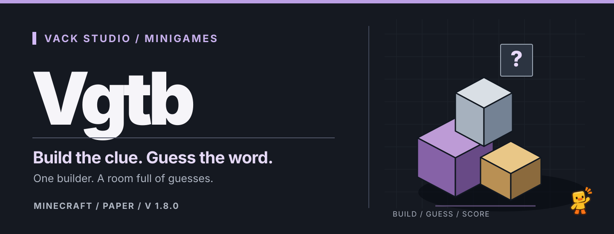
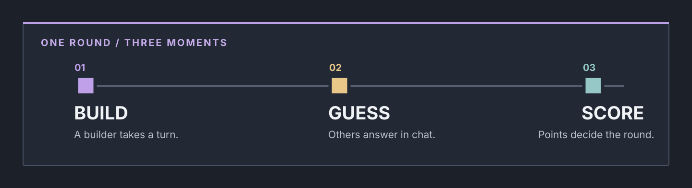

<p align="center">
  
</p>

# Vgtb 

**Build the clue. Guess the word.**

**Vgtb** is a Minecraft building-and-guessing minigame by **VACK STUDIO**. Players take turns building a secret topic while everyone else races to recognize it. Guess through chat, earn points and take your turn at the build.

> [!IMPORTANT]
> **Proprietary software.** This public repository introduces Vgtb. Source code and installable plugin builds are distributed privately with authorization from VACK STUDIO.

## How a round works

<p align="center">
  
</p>

**Can you figure out what the builder is making before everyone else?** 

The game rotates builders, handles topic selection, reveals hints and tracks guesses and scores. The inventory menu is reserved for cosmetics, not for joining a match.

## Join a match

| Action | Command |
| --- | --- |
| Enter a specific arena | `/gb1` through `/gb6` |
| Join a capacity queue | `/gb game 4`, `/gb game 8` or `/gb game 16` |
| Choose a queue and arena | `/gb game 4 2` |
| Change language | `/gb language` or `/gb language en|ar` |

Vgtb supports **English and Arabic** player preferences, saved per player. Its configured queue sizes are **4, 6, 8 and 16**, with corresponding default start thresholds of **3, 5, 6 and 12**.

## Arenas and game setup

Vgtb supports **six manually configured arenas** in existing Minecraft worlds. Waiting areas, game locations, spectator points and boundaries are set by an administrator; the plugin does not generate maps or worlds.

```text
/gb setwaiting <arena>
/gb setlobby <arena>
/gb setgame <arena>
/gb setspectator <arena>
/gb setpos1 <arena>
/gb setpos2 <arena>
```

**Setup note:** Configure all arena positions and boundaries before opening matches to players. 

Administrative setup and `/gb pack` diagnostics require `gb.admin`. VPackEngine menus require `vpack.use`.

## Cosmetics, packs and sound

The core game runs with its own cosmetic inventory fallback. Companion plugins extend the experience:

| Integration | What it adds |
| --- | --- |
| **VPackEngine 1.1.0-preview.2** | Context-aware waiting and in-game resource-pack profiles, per-arena overrides and cosmetics menus |
| **VMusic 1.7.0** | Optional NBS waiting-room music and cues, with native audio fallback |
| **VHeads 1.0.1** | Optional player-head management |

VPackEngine can select English or Arabic cosmetic menus using saved player preferences. If the engine, pack or menu is unavailable, Vgtb falls back to the standard cosmetic inventory. Pack delivery remains controlled by the VPackEngine administrator.

## Compatibility

| Component | Target or status |
| --- | --- |
| Vgtb | **1.8.0** |
| Server | **Paper 26.2 build 133** |
| Java | **Java 25** |
| Arena layout | Six manually positioned arenas |
| Leaf / Folia / Bedrock | **Not verified** |

### Verification status

The reported private Java 25 build passed **24 tests** without failures or skips, covering the VPackEngine context API, menu-request isolation, readiness and cleanup behavior. These results establish build and service-level checks, **not complete in-game acceptance**.

Live multiplayer verification is still needed for resource-pack downloads, visuals, audio and match cleanup with connected players.

## Availability and rights

Vgtb is privately distributed commercial software. For access or permission to use it, contact **VACK STUDIO** through the official links.

<p align="center">
  <a href="https://builtbybit.com/members/vack-studio.891381/#latest-activity">BuiltByBit</a>
  &nbsp;&nbsp;·&nbsp;&nbsp;
  <a href="https://discord.gg/y45brtZBEE">Discord</a>
</p>

<p align="center"><sub>© 2026 VACK STUDIO. All rights reserved. Third-party components retain their respective rights.</sub></p>
